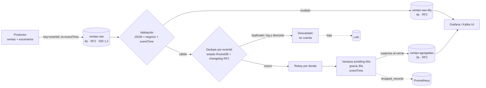

# EP5 + EP6 — Análisis del encargo, reutilización y plan de trabajo

> **Estado:** planificación. No se ha modificado código ni infraestructura.
> **Base:** laboratorio Kafka EA3 ya operativo (2 brokers + ZooKeeper + Kafka Streams + DLQ + Prometheus/Grafana/Loki).
> **Alcance nuevo:** EP5 (encargo, 12 %) + EP6 (defensa individual, 18 %) = **30 % de la asignatura**.
> **Cambio de alcance:** se eliminan Angular y RabbitMQ. Todo se concentra en Kafka y observabilidad.

---

## 1. Lectura del encargo

### 1.1 EP5 — Streaming resiliente de ventas

Se pide **evolucionar** el laboratorio actual, no rehacerlo:

| # | Requisito | Qué significa realmente |
|---|---|---|
| 1 | Reproducible | Compose + env de ejemplo + README; sin secretos reales |
| 2 | Flujo documentado | Productor → `ventas-raw` → Streams → `ventas-agregadas`; rechazo → `ventas-raw-dlq`; DTO y claves justificadas |
| 3 | Ventanas | Tumbling por **eventTime**, duración y gracia justificadas; salida con inicio/fin, conteo, monto y ticket promedio |
| 4 | Validación + DLQ | JSON y reglas de negocio; el flujo continúa; log contextual; DLQ con valor original, clave, tópico fuente y motivo |
| 5 | Duplicados | Detección por `eventId` con **estado de Kafka Streams**; explicar EOS v2 vs duplicado de negocio |
| 6 | Generador de pruebas | Válidos + JSON malformado + campo faltante/inválido + total inconsistente + `eventId` repetido + `eventTime` anterior |
| 7 | Tardíos | Política dentro/fuera de gracia; detectar descartes; **no** tratarlos como JSON inválido ni mandarlos a DLQ |
| 8 | Scripts | Crear/inspeccionar tópicos y consumer groups; particiones, RF, retención; **no RF=3** y justificar |
| 9 | Fallo de broker | ISR antes/durante/después; producción y consumo; reinicio; atraso/restauración |
| 10 | Pruebas automatizadas | Validación, DLQ, duplicados, agregación y al menos un escenario temporal; ejecutables desde el repo y resultado documentado |
| 11 | README | Arquitectura, prerrequisitos, comandos, variables, escenarios, resultados, límites, recuperación |

### 1.2 EP6 — Defensa individual

No pide código nuevo: pide **demostrar y explicar** lo construido en EP5.

- 5–10 minutos por estudiante.
- Diagrama `arquitectura_encargo.mmd` y qué implementó el equipo.
- Demostración: venta válida, mensaje defectuoso, duplicado, tardío, caída/reinicio, consumer groups/lag.
- Prometheus/Grafana; si una métrica de negocio no está instrumentada, decirlo y mostrar evidencia equivalente.
- Preguntas obligatorias: EOS v2 vs dedupe, eventTime vs arrival, ISR/RF/min.insync, restauración de estado, lag, DLQ vs tardío, ZooKeeper como SPOF.
- **Peso 18 %**, y es individual: cada integrante debe poder ejecutar y explicar.

> **Conclusión:** EP5 y EP6 son un solo proyecto. Primero se implementa y evidencia EP5; después se convierte esa evidencia en un guion de demostración.

---

## 2. Diagnóstico del desarrollo actual

### 2.1 Lo que ya sirve (no rehacer)

| Componente | Estado | Uso en EP5/EP6 |
|---|---|---|
| VPC, 4 EC2, SGs, SSM | ✅ operativo | Base; no se toca |
| ZooKeeper + 2 brokers | ✅ healthy, RF=2, ISR 1,2 | Escenario de fallo de broker |
| Tópicos `ventas-raw`, `ventas-agregadas`, `ventas-raw-dlq` | ✅ existen, RF=2 | Flujo y DLQ |
| Kafka Streams + tumbling 60 s | ✅ funcional | Extender, no reescribir |
| Producer de ventas | ✅ 1 evento/s | Extender con escenarios y timestamp |
| Compose de app/brokers/monitoring | ✅ validado | Reutilizar estructura |
| JMX + Prometheus + Grafana + Loki + Alloy + node_exporter | ✅ 10/10 targets | Evidencia EP6 |
| Kafka UI | ✅ :8080 | Inspección de tópicos, offsets, lag |
| Documentación de micro-iteraciones | ✅ | Base para README, hay que sanear secretos |

### 2.2 Brechas reales frente a EP5

| Requisito | Estado actual | Brecha |
|---|---|---|
| 1 Reproducible | ⚠️ | No hay README del proyecto ni `.env.example` de todos los hosts; hay `.env` reales con secretos |
| 2 DTO + clave justificada | ⚠️ | DTO OK; clave actual = `customerId` sin justificar y sin relación con dedupe |
| 3 eventTime | ❌ | Las ventanas usan el **timestamp del registro**, no el campo `eventTime`; gracia = 0 |
| 4 Validación + DLQ | ❌ | Solo se captura el error de parseo y se descarta; **`DLQ_TOPIC` está definido pero no se usa**; sin reglas de negocio |
| 5 Duplicados | ❌ | EOS v2 configurado, pero no existe dedupe por `eventId` ni estado asociado |
| 6 Generador de casos | ❌ | El producer solo genera ventas válidas |
| 7 Tardíos | ❌ | Gracia 0; no hay política ni evidencia de descartes |
| 8 Scripts de tópicos/grupos | ❌ | Solo comandos sueltos en documentos, no en el repo |
| 9 Fallo de broker | ❌ | No ejecutado ni documentado como evidencia |
| 10 Pruebas | ❌ | No hay `src/test`, ni JUnit, ni `kafka-streams-test-utils` |
| 11 README | ❌ | No existe README del proyecto entregable |

### 2.3 Hallazgos concretos en el código actual

1. **`StreamsApp.parse()`** descarta el evento y solo imprime `e.getMessage()`: no conserva valor, clave ni tópico → incumple requisito 4.
2. **No hay validación de negocio**: `quantity`, `unitPriceClp`, `totalClp` y `eventTime` no se validan; un total inconsistente se agrega igual.
3. **El tiempo de evento no se usa**: no hay `TimestampExtractor` ni `ProducerRecord` con timestamp explícito; el campo `eventTime` es decorativo.
4. **`WINDOW_GRACE_SECONDS=0`**: cualquier evento fuera de orden se descarta sin política explícita.
5. **`DLQ_TOPIC`** está en `app.env` pero el tópico `ventas-raw-dlq` nunca recibe datos.
6. **No hay dedupe**: dos eventos con el mismo `eventId` se cuentan dos veces.
7. **Clave actual `customerId`**: no garantiza que dos copias del mismo `eventId` caigan en la misma partición/tarea.
8. **`STATE_DIR=/tmp/kafka-streams`** dentro del contenedor: al recrear el contenedor se restaura desde changelog (bueno para demostrar recuperación, pero hay que documentarlo).
9. **Sin pruebas**: no hay forma de demostrar validación, DLQ, dedupe, agregación ni tardíos de manera repetible.
10. **Riesgo de entrega**: `broker-a.env` y `monitoring.env` contienen contraseñas reales; `kafka-1.pem` está en la carpeta. No deben publicarse.

---

## 3. Arquitectura objetivo (reutilizando la base)



### 3.1 Decisiones técnicas propuestas

| Tema | Propuesta | Justificación |
|---|---|---|
| Clave del productor | **`eventId`** | Duplicados del mismo evento caen en la misma partición/tarea, requisito para dedupe stateful; distribución uniforme; Streams reparte por tienda para agregar |
| Timestamp | `ProducerRecord` con `eventTime` + `TimestampExtractor` que lee `eventTime` | El campo gobierna las ventanas; si el JSON es inválido, el extractor cae al timestamp del registro y el evento termina en DLQ por validación |
| Ventana | **60 s tumbling** | Ventanas operativas legibles; ya está implementado y probado |
| Gracia | **30 s** | Tolera desorden/reintentos de red sin retrasar demasiado el cierre; demostrable dentro/fuera |
| Duplicados | Estado `eventos-procesados` (RocksDB) con `eventId → vistoEn + hash`, retención **24 h**, purga periódica | Sobrevive reinicios vía changelog RF2; 24 h cubre reenvíos operativos; costo ~8-10 MB/día con 1 evento/s |
| DLQ | Sink DSL a `ventas-raw-dlq` con sobre JSON | La escritura entra en la transacción de EOS; el flujo no se detiene |
| Sobre DLQ | `reason`, `source_topic`, `key`, `original`, `detected_at`, `event_id` si se pudo parsear | Cumple “valor original, clave, tópico fuente y motivo” |
| Tardíos | Dentro de gracia: se agregan. Fuera: Streams los descarta; evidencia con `kafka_streams_stream_task_metrics_dropped_records` + log; **nunca a DLQ** | Separa dato inválido de evento válido tardío |
| Tests | JUnit 5 + `TopologyTestDriver` | Sin Docker ni clúster; rápidos y repetibles; cubren topología completa |
| Estado local | Mantener `/tmp/kafka-streams` | Permite demostrar restauración desde changelog al recrear el contenedor |
| Retención tópicos | raw 7 d, agregadas 30 d, DLQ 30 d (configurable) | Balance evidencia/capacidad; se documenta en scripts |

### 3.2 Reglas de validación propuestas

| Caso | Resultado |
|---|---|
| JSON malformado | DLQ `JSON_INVALIDO` |
| Campo obligatorio ausente/vacío | DLQ `CAMPO_OBLIGATORIO:<campo>` |
| `eventTime` no ISO-8601 | DLQ `EVENT_TIME_INVALIDO` |
| `quantity <= 0` / `unitPriceClp <= 0` | DLQ `VALOR_FUERA_DE_RANGO:<campo>` |
| `totalClp != quantity * unitPriceClp` | DLQ `TOTAL_INCONSISTENTE` |
| `eventId` ya visto | Descarte + log `DUPLICADO eventId=...`; no suma |
| Mismo `eventId` con payload distinto | Descarte + log `DUPLICADO_CON_DIFERENCIAS` (se conserva el primero) |
| `eventTime` dentro de gracia | Se agrega a su ventana |
| `eventTime` fuera de gracia | Streams lo descarta; métrica `dropped_records` + log; **no DLQ** |

### 3.3 Pipeline de código propuesto (sin implementar aún)

```text
StreamsApp
├── SaleValidator            (puro, testeable)
├── DlqEnvelope              (record)
├── EventTimeExtractor       (TimestampExtractor)
├── DedupeTransformer        (estado eventos-procesados + purga TTL)
├── Topology
│   raw.split()
│     ├── válido   → parse → dedupe → selectKey(store) → windowedBy(60s, 30s)
│     │              → aggregate(ventas-por-tienda) → suppress → ventas-agregadas
│     └── inválido → DlqEnvelope → ventas-raw-dlq
└── ProducerApp / ScenarioProducer
```

- Se conserva el nombre de la app (`ventas-aggregator`), el store de agregación (`ventas-por-tienda`) y el esquema de salida actual.
- Se agrega un store nuevo (`eventos-procesados`), cuyo changelog se crea automático con RF=2.
- El sobre de DLQ es nuevo, pero `ventas-raw-dlq` está vacío: no hay compatibilidad que romper.

---

## 4. Qué se puede romper y cómo evitarlo

| Riesgo | Impacto | Mitigación |
|---|---|---|
| Rebuild/recreate de la app | Rebalanceo breve; Streams deja de agregar 1-3 min | Hacerlo en ventana controlada; verificar `RUNNING` después |
| Cambio de topología con el mismo `application.id` | Topics internos nuevos; restauración de estado | No cambiar `application.id` ni el nombre `ventas-por-tienda`; no usar `--reset-offsets` salvo prueba explícita |
| Cambio de clave `customerId` → `eventId` | Nuevos registros se reparten distinto; los antiguos no se mueven | Cambio solo afecta eventos nuevos; no requiere recrear tópicos |
| Gracia 0 → 30 s | El primer agregado sale ~30 s más tarde | Ajustar expectativas/guion; documentar |
| Store de dedupe | Topic changelog adicional (RF2) y algo de disco | Vigilar disco; retención 24 h; purga periódica |
| Tests dentro del build | Build un poco más lento | `-DskipTests` en imagen; `mvn test` aparte con script |
| Scripts de tópicos | Un `--alter` mal aplicado cambia retención | Scripts idempotentes; nunca `--delete`; revisar antes de aplicar |
| Prueba de broker | Si se detiene **kafka-1** se cae ZooKeeper y el controller | Detener **solo kafka-2** (`broker 2`), como pide el encargo |
| Reinicio de Streams | Pérdida del estado local `/tmp` al recrear contenedor | Es intencional: demuestra restauración desde changelog/offsets; documentar |
| Secretos en GitHub | Penalización directa del entregable | `.gitignore` + `.env.example` + limpieza previa; no subir `.pem` |
| Cambiar nombres de proyecto Compose | Recursos duplicados/contenedores huérfanos | Mantener `ventas-app`, `kafka-broker`, `ventas-monitoring`, `grafana-alloy`, `node-exporter` |
| `docker compose down -v` | Borra datos de Kafka | Prohibido en brokers; documentado |

### 4.1 Qué NO tocar

- VPC, subnets, rutas, SGs, SSM, EIPs.
- Configuración de ZooKeeper y brokers (salvo detener/arrancar broker 2 para la prueba).
- RF de tópicos existentes y `min.insync.replicas`.
- Prometheus/Loki/Grafana base (solo se agregan paneles/consultas).
- Nombres de tópicos de negocio y de la app de Streams.

### 4.2 Rollback

1. Antes de M1: `docker tag` de las imágenes actuales como `:v1-base`.
2. Código en rama `feature/ep5-resiliencia`; si falla, volver a `main` y reconstruir.
3. Los `.env` reales no se tocan; solo se agregan variables nuevas con defaults compatibles.
4. Si un tópico interno nuevo causa problemas, detener consumer; los datos de negocio permanecen.

---

## 5. Plan de trabajo por micro-iteraciones

> Cada iteración termina con un criterio verificable. No se avanza si el anterior no está demostrado.

### M0 — Línea base y espacio seguro (≈30 min)
- Ejecutar `deploy/verify-lab.ps1` → 31/31 PASS.
- Guardar evidencias base: `kafka-topics --describe`, ISR, consumer groups, captura de Grafana.
- Etiquetar imágenes actuales `ventas-app-producer:v1-base`, `ventas-app-consumer:v1-base`.
- Crear estructura del repo entregable y `.gitignore` (secretos, `.pem`, `.env`).
- **Salida:** línea base reproducible + rollback listo.

### M1 — Validación, DLQ y eventTime (≈2-3 h)
- `SaleValidator`, `DlqEnvelope`, `EventTimeExtractor`.
- Producer: clave `eventId` + timestamp desde `eventTime`.
- Topología: `split` válido/inválido; sink a DLQ; logs contextuales.
- Tests: JSON malformado, campo faltante, total inconsistente, evento válido.
- Desplegar y probar los 3 casos inválidos; verificar consumidor vivo y DLQ íntegra.
- **Salida:** 3 casos en DLQ con motivo/clave/original; flujo válido sigue agregando; tests verdes.

### M2 — Deduplicación por `eventId` (≈1.5-2 h)
- `DedupeTransformer` + store `eventos-procesados` + purga TTL.
- Config `DEDUPE_RETENTION_SECONDS=86400`.
- Tests: mismo `eventId` dos veces; mismo `eventId` con payload distinto.
- E2E: duplicado no altera conteo/monto; log y estado visibles; changelog RF2.
- **Salida:** evidencia de no-duplicación + explicación EOS vs negocio.

### M3 — Política de tardíos y gracia (≈1-1.5 h)
- `WINDOW_GRACE_SECONDS=30`; escenarios dentro/fuera de gracia.
- Test temporal con `TopologyTestDriver`.
- Evidencia de `dropped_records` y log de descarte; confirmar que no va a DLQ.
- **Salida:** política demostrada y diferenciada de dato inválido.

### M4 — Suite de pruebas y scripts reproducibles (≈1.5 h)
- Completar tests: agregación, ventana, validación, DLQ, duplicados, tardíos.
- `scripts/run-tests.sh` (Maven en Docker, sin depender de Maven local).
- `scripts/create-topics.sh`, `describe-cluster.sh`, `consumer-groups.sh`, `scenarios.sh`.
- Documentar resultado real de `mvn test`.
- **Salida:** `mvn test` reproducible y scripts ejecutables desde el repo.

### M5 — Recuperación y evidencia operativa (≈1.5-2 h)
- Prueba broker 2: ISR antes/durante/después; producción y consumo; reinicio y catch-up.
- Reinicio de Streams: restauración desde changelog/offsets; sin doble conteo.
- Capturas/salidas CLI en `evidence/`.
- Opcional: paneles Grafana para DLQ, duplicados (Loki) y `dropped_records`; alertas.
- **Salida:** matriz de escenarios con evidencia real.

### M6 — README, diagrama y limpieza del repo (≈1.5 h)
- README con las 11 secciones exigidas.
- `arquitectura_encargo.mmd` (Mermaid) con tópicos, claves, particiones, RF, DLQ.
- `.env.example` para todos los hosts; eliminar secretos y `.pem` del repo.
- Verificar `docker compose config` con ejemplos; índice de evidencias.
- **Salida:** repo clonable y reproducible sin editar código.

### M7 — Ensayo EP6 (≈1-1.5 h)
- Guion cronometrado 5-10 min con comandos exactos.
- Evidencia de respaldo si la nube falla (salidas pregrabadas).
- Hoja de respuestas para las 7 preguntas obligatorias.
- Ensayo individual de cada integrante.
- **Salida:** demo completa y defensa lista.

**Total estimado:** 9-12 h de trabajo efectivo, repartibles en 3-4 sesiones.

---

## 6. Cobertura de la pauta

### EP5 (12 %)

| Indicador | Peso | Iteración que lo cubre |
|---|---|---|
| Cliente Kafka, tópicos, configuración reproducible | 15 % | M0, M4, M6 |
| Productor, consumidor y diseño de eventos | 15 % | M1 |
| Ventanas, agregación y eventTime | 15 % | M1, M3 |
| Validación, logs y DLQ | 15 % | M1 |
| Duplicados y semántica de entrega | 15 % | M2 |
| Recuperación y observabilidad operativa | 10 % | M5 |
| Pruebas, documentación y entrega | 15 % | M4, M6 |

### EP6 (18 %)

| Indicador | Peso | Cómo se cubre |
|---|---|---|
| Arquitectura y decisiones | 10 % | M6 diagrama + M7 guion |
| Flujo normal y tópicos | 15 % | Ya operativo; guion M7 |
| Inválidos y DLQ | 15 % | M1 + M7 |
| Duplicados y garantías | 15 % | M2 + M7 |
| Tiempo de evento y ventanas | 10 % | M3 + M7 |
| Tolerancia a fallos y recuperación | 15 % | M5 + M7 |
| Consumer groups y métricas | 10 % | M4 scripts + Kafka UI |
| Comunicación y defensa individual | 10 % | M7 ensayo |

---

## 7. Estructura propuesta del repositorio entregable

```text
.
├── README.md
├── arquitectura_encargo.mmd
├── .gitignore                 # *.pem, **/*.env, !**/*.env.example, target/
├── app/
│   └── app/                   # Maven + Dockerfile
│       ├── pom.xml
│       ├── Dockerfile
│       └── src/main/java/cl/duoc/ventas/
│           ├── ProducerApp.java
│           ├── ScenarioProducer.java   (nuevo)
│           ├── StreamsApp.java
│           ├── Sale.java
│           ├── SaleValidator.java      (nuevo)
│           ├── DlqEnvelope.java        (nuevo)
│           ├── EventTimeExtractor.java (nuevo)
│           ├── DedupeTransformer.java  (nuevo)
│           ├── TicketAggregate.java
│           └── WindowResult.java
│       └── src/test/java/cl/duoc/ventas/
│           ├── ValidationTest.java
│           ├── DlqTest.java
│           ├── DedupeTest.java
│           ├── AggregationTest.java
│           └── LateEventTest.java
├── deploy/
│   ├── kafka-1/  docker-compose.broker.yaml + broker-a.env.example
│   ├── kafka-2/  docker-compose.broker.yaml + broker-b.env.example
│   ├── app/      docker-compose.app.yaml + app.env.example
│   └── monitoring/ compose + provisioning + *.env.example
├── scripts/
│   ├── create-topics.sh
│   ├── describe-cluster.sh
│   ├── consumer-groups.sh
│   ├── scenarios.sh
│   ├── run-tests.sh
│   └── broker-failure.sh
├── docs/
│   ├── matriz-escenarios.md
│   ├── demo-ep6.md
│   └── preguntas-defensa.md
└── evidence/
    ├── baseline/
    ├── dlq/
    ├── duplicados/
    ├── tardios/
    ├── broker-failure/
    └── streams-restart/
```

---

## 8. Decisiones que necesito confirmar antes de codificar

| # | Decisión | Recomendación |
|---|---|---|
| 1 | Clave del productor | **`eventId`** (correcta para dedupe); alternativa `customerId` con riesgo de duplicados entre particiones |
| 2 | Gracia de ventana | **30 s**; alternativa 60 s para demos más holgadas |
| 3 | Retención de dedupe | **24 h**; alternativa 7 d (más estado, más disco) |
| 4 | Retención de tópicos | raw 7 d, agregadas 30 d, DLQ 30 d; ajustable |
| 5 | Repositorio | Crear repo nuevo limpio (recomendado) vs reutilizar carpeta actual con limpieza de secretos |
| 6 | Paneles de negocio en Grafana | **Sí, opcional en M5**: DLQ, duplicados (Loki), `dropped_records` |
| 7 | Alcance de métricas | No instrumentar contadores custom; usar JMX/Loki/CLI y declararlo en EP6 |

---

## 9. Recomendación de arranque

1. **M0** el mismo día: baseline, backup de imágenes, repo limpio y `.gitignore`.
2. **M1** primero: validación + DLQ + eventTime es el corazón del encargo y alimenta 4 indicadores de EP5.
3. **M2** duplicados inmediatamente después: es el segundo bloque de mayor peso y el más preguntado en EP6.
4. **M3** tardíos: cierra la semántica temporal.
5. Recién después: pruebas, scripts, recuperación y documentación.
6. **EP6 se prepara con evidencia real**, no con diapositivas inventadas.

> No se desarrolla de cero: se conserva el 70-80 % del laboratorio y se interviene solo la app, los datos de prueba, la documentación y los guiones de evidencia.
